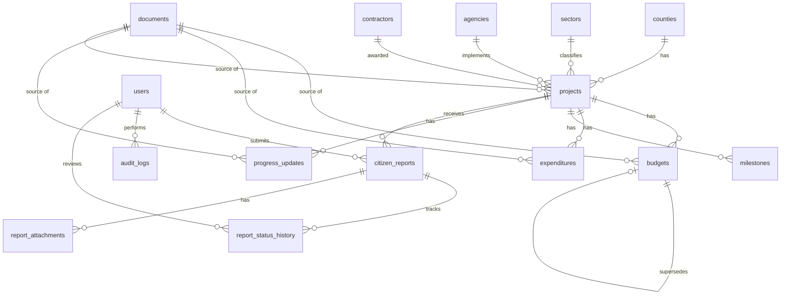

# Database Design (MVP draft)

Conventions: UUID or bigint primary keys, `created_at` / `updated_at` on
all tables, money as NUMERIC(18,2), statuses as VARCHAR with CHECK.
Missing data = no row or NULL, never zero.

## ER diagram

## Tables

### users
id, email (unique), password_hash, full_name, role (admin | reviewer | citizen), is_active

### counties
id, name (unique), code (1-47)

### sectors
id, name (unique)  -- health, education, water, roads, ...

### agencies
id, name, county_id (nullable; null = national agency)

### contractors
id, name, registration_no (nullable)

### documents  (source of truth for every figure)
id, title, source_name, url (nullable), file_path (nullable),
document_type (budget | implementation_report | audit | tender_notice | award | other),
financial_year (nullable), period_label (nullable), published_date (nullable),
recorded_at, recorded_by -> users

### projects
id, name, description (nullable), county_id, sub_county (nullable),
location_text (nullable), latitude/longitude (nullable),
sector_id (nullable), agency_id (nullable), contractor_id (nullable),
start_date (nullable), expected_completion (nullable), actual_completion (nullable),
status (planned | ongoing | completed | delayed | suspended | stalled | unknown),
source_document_id -> documents, verification_status,
recorded_by, is_archived

### budgets  (append-only)
id, project_id, budget_type (approved | revised | committed),
amount NUMERIC(18,2) NOT NULL, financial_year, reporting_period,
source_document_id, verification_status,
supersedes_id -> budgets (nullable), notes, recorded_by, recorded_at

### expenditures
id, project_id, amount NUMERIC(18,2) NOT NULL, financial_year,
period_start, period_end, is_cumulative BOOLEAN NOT NULL,
source_document_id, verification_status, notes, recorded_by, recorded_at

### milestones
id, project_id, title, description, planned_date (nullable),
actual_date (nullable), status (pending | in_progress | done | delayed),
sort_order

### progress_updates
id, project_id, milestone_id (nullable), update_date, summary,
percent_complete (nullable, only with credible assessment),
source_document_id (nullable), verification_status, recorded_by

### citizen_reports
id, project_id, reporter_user_id (nullable = anonymous),
description, observed_at, latitude/longitude (nullable),
contact_email (nullable, never public), contact_phone (nullable, never public),
status (submitted | under_review | awaiting_information | verified |
unverified | disputed | rejected | resolved),
is_public BOOLEAN DEFAULT false, created_at

### report_status_history
id, report_id, from_status, to_status, reviewer_id -> users, note, changed_at

### report_attachments
id, report_id, file_path, mime_type, size_bytes, uploaded_at

### audit_logs
id, user_id, action, table_name, record_id, before JSON, after JSON, created_at

## Verification status values
official | verified | citizen_submitted | unverified | disputed

## Open questions (resolve after data check)
- Does the real data give project locations? If so, how precise?
- Do project names stay consistent across quarterly reports?
- One contractor per project, or many (would need a join table)?
